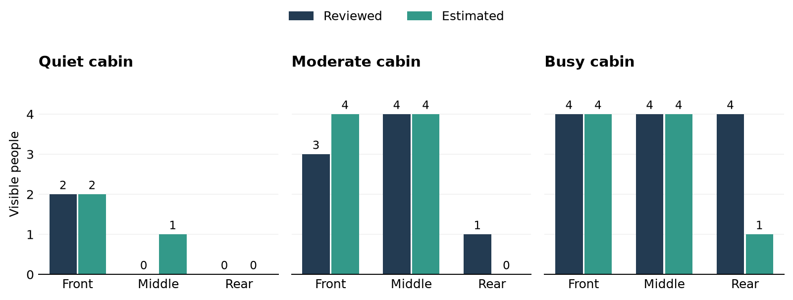

# Prototype evaluation

The doorway experiments use public PCDS video. The cabin experiments use Inside Bus View test images. Only anonymous aggregate replays are included in the dashboard. Data source and license records are in [the project registry](../datasets/sources.csv).

## Doorway flow

The reference is a visually reviewed crossing time and physical direction. A prediction must fall within 0.5 seconds of the reference and have the same direction. Each prediction and reference can match once. Labels were reviewed once. A review at the limit of the time window can change a match.

The first three clips were used for development. The general person detector at confidence 0.10 with ByteTrack matched 4 of 10 events at 0.24 s track memory. Extending memory to 0.80 s recovered two entries and one exit on the same tracks, for 7 of 10 with zero extra events. The longer gap permits an interpolated crossing between two observations with the same ID. Identity swaps remain a possible source of false events.

The additional references below were fixed before predictions on each view. Both gap settings produced the same result. The queue test covers the first 156 frames of sample 0019, scored as a separate clip.

| Recording | Reviewed events | Matched | Extra |
| --- | ---: | ---: | ---: |
| 0006 | 5 boarding | 4 | 0 |
| 0017 | 3 alighting | 3 | 0 |
| 0019 queue excerpt | 3 boarding | 1 | 0 |
| Total | 11 | 8 | 0 |

The two reviewed no-crossing intervals total 15.8 seconds and produced zero events. The queue excerpt is the clearest failure case. The confidence and 0.80 s profile remain experimental. Review times and intervals are under `evaluation/doorway_*csv`.

## Cabin distribution and seats

Each still is repeated for three seconds to exercise decoding, tracking, and temporal confirmation. Each physical seat or zone in a still contributes one scored observation. The three calibration stills have eight mapped seats each. A later image from the same camera contributes a separate check on its four front seats and front-zone count. Camera orientation and visibility are specific to this view.

| Observation | Result |
| --- | --- |
| Seat state, calibration scenes | 18/24 exact matches, including uncertain. Eight estimates were uncertain. |
| False availability, calibration scenes | 0 after adding a bag veto and marking the partition-obscured seat base. Two false available estimates occurred in the initial run. |
| Additional February still | 4/4 front-seat states correct. Front-zone count 4, reviewed count 4. Other positions in this still were unscored. |
| Front / middle / rear mean absolute count error on the three calibration scenes | 0.33 / 0.33 / 1.33 people. The busy rear zone returned 1 of 4 visible people. |
| Zone detector comparison | The general person detector produced 10 total absolute errors across nine zone observations. The cabin passenger checkpoint produced 6. This comparison used the calibration scenes. |



Regenerate the figure with `python -m evaluation.plot_zones`.

A seat becomes available only after consistent detection evidence. A conflicting seat prediction, a bag overlapping the candidate seat, a configured occluded seat base, or a lost observation can produce uncertainty. The rear has limited visibility. A calibrated capacity is necessary to estimate remaining places. The real cabin configuration has no measured capacity.

## Persistent obstruction review

The camera pipeline tracks suitcases, backpacks and handbags in a configured passage. The lower box center must remain inside the region and within a stationary tolerance for the dwell interval. The result asks an operator to inspect a possible obstruction. A large object of an unsupported class, a carried bag that remains still, and a partially blocked passage are all relevant limitations. A standing passenger by themselves does not trigger the luggage rule.

The pixel-level positive control uses a bag cut from the quiet cabin image and composited onto its aisle. At 10 FPS it appears briefly from 1.0 to 1.7 s, then from 3.0 to 7.0 s. The complete detector, tracker and geometry pipeline yielded one sustained alert and zero extra alert episodes. The first saved alert was at 5.1 s and the first saved observation after removal was at 7.2 s. No alert occurred during the brief placement. Four actual cabin stills without annotated aisle luggage yielded zero alert episodes. Physical obstruction sensitivity still requires consented video of real placements and removals in a fixed camera view.

The separate controlled-stop simulation injects detections into the measurement engine. It exercises two boardings, one exit, a persistent suitcase, a transient backpack, and one second of poor visibility. It tests the decision logic independently of detector quality.

## Detector scores and split quality

Re-evaluated on the development Mac with the existing checkpoints, CPU inference and 640-pixel model input.

| Detector and split | Images | Precision | Recall | mAP50 | mAP50–95 |
| --- | ---: | ---: | ---: | ---: | ---: |
| Clean seat checkpoint, cleaned test | 141 | .901 | .839 | .877 | .497 |
| Passenger checkpoint, original validation | 100 | .978 | .961 | .981 | .884 |

A cross-split SHA-256 scan found zero byte-identical train/evaluation images in either dataset. One seat test image shares its pre-export filename stem with a training image. A 64-bit difference-hash screen at Hamming distance ≤4 flagged 119/141 seat test images and 31/100 passenger validation images as similar to a training image. Repeated geometry in a fixed camera can produce similar hashes for different scenes. These are review candidates. The published splits do not establish generalization across recording sessions. A defensible deployment study needs separate sessions, viewpoints, lighting, occlusion and independent human labels.

## Runtime and physical validation

| Apple M4 CPU workload | Frames/run | Processing FPS | Processing p95 | Sampled peak RSS |
| --- | ---: | ---: | ---: | ---: |
| Doorway 0006, general detector | 535 | 40.02 | 26.06 ms | 432.9 MiB |
| Cabin stills, passenger + luggage + seat detectors | 30 | 12.82–14.14 | 55.22–73.69 ms | 478.7–482.2 MiB |
| Composite aisle trial, three detectors | 80 | 14.52 | 67.5 ms | 477.5 MiB |

Processing FPS uses elapsed wall time from the first decoded frame through the run, excluding model loading. Processing latency covers frame quality, model inference, tracking and spatial measurements. Peak RSS is sampled per frame. Short replay runs and concurrent host activity affect these values. OAK transport, physical RGB-D alignment, and Raspberry Pi performance have separate bench steps. [Hardware procedure](edge.md)

## Reproduce the scores

From the repository root, the commands below use the project environment. The dashboard replays suffice for the cabin scores. For the fresh doorway comparison, first create the converted videos and frame logs from local PCDS data.

```sh
mkdir -p results/converted_videos
for id in 0006 0017 0019; do
  ffmpeg -n -i "datasets/raw/people_counting/sample/videos/sample_$id.avi" \
    -c:v libx264 -pix_fmt yuv420p -an "results/converted_videos/sample_$id.mp4"
done
ffmpeg -n -i results/converted_videos/sample_0019.mp4 -frames:v 156 \
  -c:v libx264 -pix_fmt yuv420p -an results/converted_videos/sample_0019_queue.mp4
for clip in sample_0006 sample_0017 sample_0019_queue; do
  .venv/bin/python inference/track_passengers.py --weights yolo11n.pt --conf 0.10 \
    --source "results/converted_videos/$clip.mp4" --calibration "configs/pcds_${clip}_door.json" \
    --output "results/doorway/${clip}_person_low.mp4" --debug-csv "results/doorway/${clip}_person_low.csv"
done
.venv/bin/python -m evaluation.compare_doorway_gaps
.venv/bin/python -m evaluation.score_cabin --phase calibration
.venv/bin/python -m evaluation.score_cabin --phase additional
.venv/bin/python -m evaluation.score_obstruction
.venv/bin/python -m evaluation.audit_splits
.venv/bin/python -m unittest discover -s tests -v
```

The fine-tuned detector evaluations use `training/evaluate_passengers.py` and `training/evaluate_seats.py`. To regenerate the pixel-level aisle input run `python -m evaluation.bag_fixture`; process its output with the cabin monitor command in the README. Regenerate the synthetic detection replay with `python -m evaluation.simulated_stop`.
